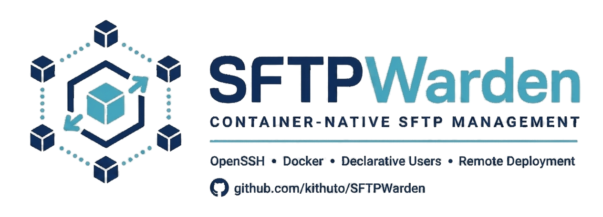

<p align="center">
  <picture>
    <source media="(prefers-color-scheme: dark)" srcset="docs/_static/logo-sftpwarden-dark.svg">
    <source media="(prefers-color-scheme: light)" srcset="docs/_static/logo-sftpwarden-light.svg">
    
  </picture>
</p>

<p align="center">
  Run an SFTP server in a container and manage its users from the command line.
</p>

SFTPWarden helps you set up a server for transferring files over SSH, control who
can connect and keep user files and server identity across container
replacements. OpenSSH handles the file transfers; SFTPWarden manages the users,
configuration and deployment.

**Keep SFTP users in sync automatically.** Add or update accounts through the CLI
or directly in your YAML file, database or other configured provider. SFTPWarden
applies the user changes available to the running server, so you can grant access
whenever it is needed without rebuilding the image or restarting the server.
See [automatic user synchronization](docs/operations.md#automatic-user-synchronization)
for timing and deployment-specific delivery.

Use it for a team upload server, an automated file exchange or a local SFTP
environment for development. Start with Docker Compose and a YAML file of users.
Remote servers, database-backed users and Kubernetes are available when your
environment needs them.

This documentation covers **SFTPWarden 1.4.0**. If you are upgrading an existing
installation, read the [recovery and upgrade guide](docs/recovery.md) first.

## Table of Contents

- [Key Features](#key-features)
- [Installation](#installation)
- [Shell Autocomplete](#shell-autocomplete)
- [Quick Start](#quick-start)
- [Deployment Choices](#deployment-choices)
- [Project Files](#project-files)
- [User Management](#user-management)
- [Providers](#providers)
- [Operations](#operations)
- [Updating](#updating)
- [Backup and Restore](#backup-and-restore)
- [Security](#security)
- [Documentation](#documentation)
- [Roadmap](#roadmap)
- [Contributing](#contributing)

## Key Features

- **Synchronize users automatically:** keep server accounts aligned with your
  provider, whether changes come from a command, a manual edit or another system.
- **Manage access:** add users, use passwords or SSH keys and revoke access.
- **Keep user files:** store uploads, server keys and operational state outside
  the container image.
- **Choose where users live:** use a file or connect to a supported database.
- **Manage several environments:** select a named context instead of repeating
  connection settings.
- **Deploy where you need it:** use local or remote Docker Compose, Kubernetes
  manifests or Helm.

The server provides SFTP access within each user's restricted directory. It does
not provide an end-user web portal, FTP/FTPS or a general-purpose SSH shell.

## Installation

You need Python **3.11 or newer**. The quick start also needs a running Docker
engine with **Compose v2**, plus the OpenSSH `sftp` and `ssh-keygen` clients.

Install SFTPWarden:

```bash
python -m pip install sftpwarden
```

For development from source, see
[Contributing](docs/contributing.md#install-from-source).

YAML, CSV and SQLite need no additional provider dependencies. For an external
database, see the [provider guide](docs/providers.md).

## Shell Autocomplete

Run `sftpwarden --install-completion`, then open a new terminal. Shell completion
helps you find commands and options as you type.

<a id="5-minute-quick-start"></a>

## Quick Start

This example creates a local server accessible only from your own machine.
Use a new directory and context name. Choose and confirm Alice's password when
prompted:

```bash
mkdir ~/sftpwarden-demo
cd ~/sftpwarden-demo
sftpwarden init demo --yes
sftpwarden config server.host 127.0.0.1
sftpwarden user create alice --no-refresh
sftpwarden deploy
```

Connect with Alice's password:

```bash
sftp -P 2222 alice@127.0.0.1
```

On your first connection, [verify the server fingerprint](docs/getting-started.md#connect-and-transfer-a-file)
before accepting it. Use the `upload/` directory for files and `bye` to disconnect.

YAML is the default user provider. You can choose another with `--provider` or
change the [global default](docs/getting-started.md#create-a-first-project).
For a complete first transfer and the recommended SSH key setup, follow
[Getting Started](docs/getting-started.md).

## Deployment Choices

Choose where the server runs independently of where you store user accounts.
Docker Compose is the default; Kubernetes is optional.

| Model | Choose it when | Guide |
| --- | --- | --- |
| Local Compose | You administer Docker on the same machine as the CLI. Useful for learning and single-host installations. | [Local runtime](docs/operations.md#local-runtime) |
| Remote local-sync | You keep project files on your workstation and deploy to a server over SSH. | [Remote deployment](docs/operations.md#remote-deploy) |
| Remote-only | A project already exists on the server and you want to administer it in place. | [Remote deployment](docs/operations.md#remote-deploy) |
| Kubernetes / Helm | You already operate a cluster and want to deploy through manifests or a chart. | [Kubernetes deployment](docs/operations.md#kubernetes-deploy) |

## Project Files

The project directory holds `sftpwarden.yaml` (settings), a user provider and
generated deployment files. For local Compose, `data/` holds uploads,
`host_keys/` preserves server identity and `state/` preserves runtime state.

These files have different roles. A user provider stores accounts and
credentials; it does not store uploaded documents.
[Getting Started](docs/getting-started.md#create-a-first-project) explains the
layout before and after the first deploy.

## User Management

With the demo running:

```bash
sftpwarden user create bob
sftpwarden users
sftpwarden user show bob
```

The create command asks for Bob's password and normally applies his access
immediately. You can also edit the active provider directly: automatic
synchronization is enabled by default and its periodic interval is 60 seconds.
Use the provider's supported format; passwords stored there must be hashes.

Removing a user does not delete their uploaded files unless you explicitly request that.
See the [user command reference](docs/cli/users.md) for updates, disablement,
removal and deployment-specific behavior.

### User Schemas and Named Keys

New projects use schema v2, which supports named keys, rotation and expiry.
Schema v1 remains supported for existing projects. You do not need to choose a
schema to complete the quick start.

See [Named Keys](docs/named-keys.md) when you need to manage several credentials
for one account or migrate an existing provider.

## Providers

A provider is the file or database that stores the SFTP accounts.

| Need | Provider options |
| --- | --- |
| Start with an editable file | YAML |
| Exchange tabular user records | CSV |
| Keep accounts in a local database file | SQLite |
| Connect to an existing database service | MySQL, MariaDB, PostgreSQL, MongoDB |

Start with YAML if you have no existing database requirement. The
[provider guide](docs/providers.md) covers dependencies, formats, capabilities,
concurrent edits and migration.

## Operations

User synchronization runs automatically by default. Deploy applies project
settings; refresh lets you request a user update without waiting:

| Change | Apply it with |
| --- | --- |
| Project settings, such as the published port | `sftpwarden deploy` |
| User data already visible to the running server | Automatic synchronization or `sftpwarden refresh` to apply it now |

The remote watcher delivers editable user provider files; it does not deploy
project configuration. Kubernetes YAML/CSV user changes need a deploy to deliver
the file to the cluster.

Follow [Configuration](docs/configuration.md#change-the-local-sftp-port) for a
complete port-change example or [Operations](docs/operations.md) for deployment,
synchronization, health and troubleshooting.

## Updating

Check releases with `sftpwarden upgrade --check`, preview with `--dry-run`, then
run `sftpwarden upgrade` to update the CLI and installed watcher. Servers keep
their current version until `sftpwarden deploy --context NAME` applies the update.
Take a verified backup before maintenance.

If the new watcher is incompatible with a deployment, upgrade warns before making
changes and asks permission to deploy **all contexts**, which may interrupt
transfers. See the [update guide](docs/cli/upgrade.md), including the one-time
installer update needed by CLIs older than 1.4.0.

## Backup and Restore

Backups can preserve configuration, users, server identity and runtime state.
Uploaded files require an explicit `--include-data` option. Archives may contain
secrets and must be protected accordingly.

Follow the [recovery guide](docs/recovery.md) to choose a capture and restore
procedure for your deployment. A usable recovery includes checking access,
uploaded files and server identity after activation.

## Security

The quick start binds to `127.0.0.1` for local access. Before making a server
available to other machines, review authentication, network exposure, host keys
and backups in the [security guide](docs/security.md).

SFTP users have restricted directories, but you remain responsible for the
Docker host, credentials and persistent storage. Keep private keys and backups
out of source control.

## Documentation

| I want to… | Read |
| --- | --- |
| Set up a server and transfer my first file | [Getting Started](docs/getting-started.md) |
| Understand and change settings | [Configuration](docs/configuration.md) |
| Know how a change becomes active | [Configuration Effects](docs/configuration-effects.md) |
| Choose account storage | [Providers](docs/providers.md) |
| Rotate or expire SSH keys | [Named Keys](docs/named-keys.md) |
| Deploy and administer an environment | [Operations](docs/operations.md) |
| Recover or upgrade an installation | [Recovery](docs/recovery.md) |
| Review security responsibilities | [Security](docs/security.md) |
| Look up commands and options | [CLI Reference](docs/cli-reference.md) |

The documentation uses Sphinx. Build instructions are in
[Contributing](docs/contributing.md#documentation).

## Roadmap

These are planned capabilities. See the [changelog](CHANGELOG.md) for release
history and the longer future roadmap.

### v1.5 - Audit and Transfer Visibility

Audit events, transfer visibility and richer runtime status.

### v1.6 - Security and Client Trust

Security check profiles, secret-file support and assisted host-key management.

## Contributing

Bug reports, documentation improvements, examples and code contributions are
welcome. Create a branch from `dev` and open normal pull requests against `dev`.

- [Contribution workflow](CONTRIBUTING.md)
- [Development setup and validation](docs/contributing.md)
- [Report a vulnerability](SECURITY.md)
- [Code of conduct](CODE_OF_CONDUCT.md)

SFTPWarden is licensed under the [MIT License](LICENSE).
